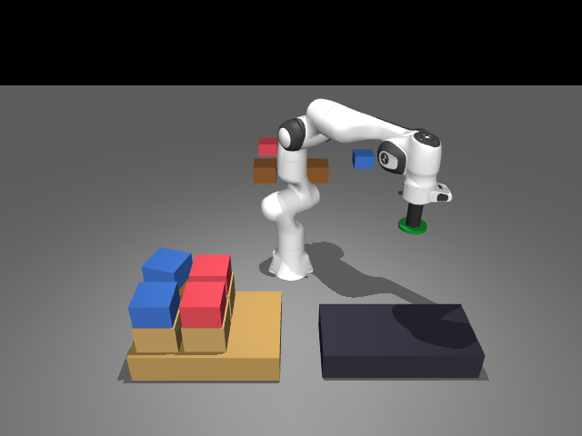
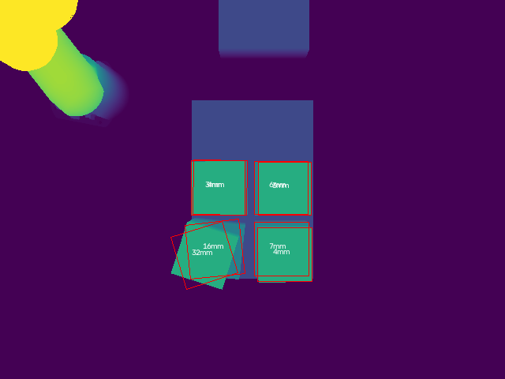

# Mixed-Case Robotic Palletizing Cell (MuJoCo, simulation only)

**Simulation only.** A Franka Panda arm with a vacuum end-of-arm tool picks mixed cases from a
conveyor pick spot and stacks them into pallets in MuJoCo. A state machine runs the cell, a layer
planner decides where each case goes (heavy/strong low, crush limits, flat layers), fixed overhead
depth cameras + OpenCV measure pick-and-place quality, and a small PyTorch model flags risky picks.
Personal learning project; no real robot, gripper, conveyor, ROS 2 or PCL is involved, and it is not
based on any company's software.

 

## What is in it
| File | What it does |
|---|---|
| `cases.py` | 4 case types (size, mass, crush rating = max kg on top); masses stay at or under the Panda's 3 kg payload. |
| `build_scene.py` -> `scene/cell.xml` | MJCF: Panda + vacuum tool (`scene/panda_suction.xml`, from MuJoCo Menagerie `panda_nohand.xml`), conveyor pick zone, pallet, 12 free case bodies, one `weld` equality per case (the vacuum grip, off by default), pick camera (oblique) + pallet camera (top-down), overview camera. |
| `sim.py` | Physics stepping on the Panda's position actuators, damped-least-squares IK for the tool point, straight-line TCP moves, vacuum gripper: seal check (pad-case contact + pad overlap >= 50 %), weld on/off, per-step holding check (pull force m(a-g) and peel torque vs vacuum capacity) -> drop with cause. |
| `state_machine.py` | IDLE -> PERCEIVE -> PICK -> TRANSFER -> PLACE -> VERIFY -> NEXT, plus REPLAN (case missing / lost), RETRY (seal fail or risky grasp), FAIL; illegal transitions raise; every transition logged to JSONL. |
| `planner.py` | Rule-aware greedy layer planner (2 x 3 columns, up to 3 layers), replans with already-placed cases fixed; first-fit baseline; rule checker (crush, heavy-on-light, uneven layer, overflow). |
| `vision.py` | MuJoCo RGB-D render -> per-pixel world height map -> height band -> OpenCV contours + `minAreaRect` (centre, footprint, yaw) + least-squares plane (tilt). |
| `metrics.py` | Per-case placement error (mm), yaw, tilt, top-height error, gap to neighbours; per-layer flatness. |
| `grasp_model.py` | Randomized pick sweep -> curated dataset `results/grasp_dataset.csv` -> MLP (6-32-32-1, CPU) vs a pad-offset rule on a held-out split -> `results/grasp_model.json`, `results/grasp_mlp.pt`. |
| `eval.py` | 50 randomized pallets (case mix, pick pose noise, pad positioning error, vacuum level, missing cases) -> `results/eval_summary.json` + per-case / per-pallet / transition logs. |
| `make_results.py` | Writes `RESULTS.md` from the results files. |
| `render_pallet.py` | The two pictures above. |
| `tests/` | pytest: planner rules vs first-fit, crush rule, replanning, transition table, illegal transition, one pallet with a missing case (REPLAN path), seal check fails off-centre, metrics on a known placement. |

## How to run
```bash
export UV_CACHE_DIR=~/workspace/.tools/uv-cache UV_PYTHON_INSTALL_DIR=~/workspace/.tools/python
~/workspace/.tools/bin/uv venv --python 3.12 .venv
~/workspace/.tools/bin/uv pip install --python .venv/bin/python mujoco numpy opencv-python-headless pytest
~/workspace/.tools/bin/uv pip install --python .venv/bin/python torch --index-url https://download.pytorch.org/whl/cpu
export MUJOCO_GL=egl
.venv/bin/python build_scene.py                          # scene/cell.xml
.venv/bin/python grasp_model.py sweep --n 360 --workers 3 # curated pick data
.venv/bin/python grasp_model.py train                    # grasp-risk model
.venv/bin/python eval.py --pallets 50 --workers 3 --seed 0
.venv/bin/python -m pytest -q
.venv/bin/python failure_breakdown.py && .venv/bin/python make_results.py && .venv/bin/python render_pallet.py
```

## Numbers
From `results/eval_summary.json` and `results/grasp_model.json` (full table + sources in `RESULTS.md`).
50 randomized pallets (`eval.py --pallets 50 --seed 0`, 434 cases ordered, 11 missing injected):

| Metric | Value |
|---|---|
| Pallets fully correct | 22 / 50 (0.44) |
| Drops by cause | peel 13 (pull 0) |
| Unstable cases after settle / cases not found by the camera | 32 / 16 (of 409 placed) |
| Placement error from the depth camera (mm), 393 cases | mean 9.11, median 4.84, p95 39.62 |
| Top-face tilt from depth (deg) | mean 0.252, max 33.0 |
| Rule violations: planner vs first-fit on the same cases | 0 vs 149 |
| Grasp-risk MLP vs offset rule, held-out accuracy (90 picks) | 0.956 vs 0.700 |
| pytest | 9 passed |

**Read these honestly:** 22/50 is the real pallet success rate. Most failures are knocked or
shifted cases (the cell has no collision-aware planner; straight-line moves next to 2-3 cm gaps)
and peel drops; see `RESULTS.md` and `BUILD-LOG.md`.

## Limits (read these)
- Vacuum physics is a simple model (holding force = vacuum x sealed area, peel lever = 0.4 x pad radius); drops and grasp labels come from it, so the grasp model learns this simulator, not a real gripper.
- Pad positioning error is injected (sigma 12 mm) and treated as measured by the pick camera before suction.
- No collision-aware motion planner: straight-line moves at a safe height. The first-fit baseline is rule-checked only, not executed.
- Cases arrive from a sequencing buffer in the order the planner asks for (teleported to the pick spot).
Details in `BUILD-LOG.md`.

## Credits
Franka Emika Panda model: [MuJoCo Menagerie](https://github.com/google-deepmind/mujoco_menagerie) (Apache-2.0, `assets/franka_emika_panda/LICENSE`).
