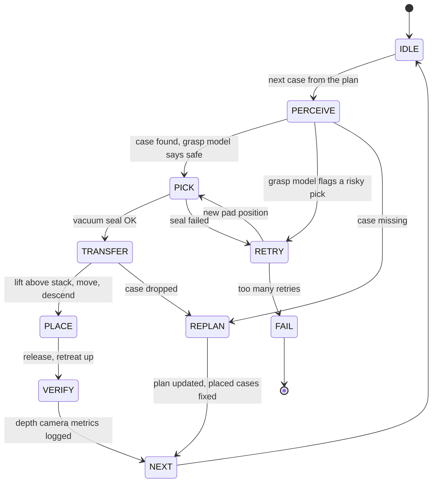

# Mixed-Case Robotic Palletizing Cell

**A warehouse palletizing cell in MuJoCo.** A Franka Panda with a vacuum end-of-arm tool picks mixed cases. A state machine runs every pick and place, and a rule-aware planner decides where each case goes. A depth camera with OpenCV measures how well each case landed, and a small PyTorch model warns before risky grasps.


| Finished pallet (side view) | Pallet camera: depth + OpenCV contours |
|---|---|
|  |  |

## Results at a glance
Every run uses the same 50 randomized pallets (`eval.py --pallets 50 --seed 0`, 434 cases ordered, 11 missing on purpose).

| Run | Pallets fully correct | Cases dropped | Cases knocked / unstable | Median placement error |
|---|---|---|---|---|
| v1: first motion strategy | 22 / 50 | 13 | 32 | 4.84 mm |
| **v2: vertical approach + retreat** | **36 / 50** | **13** | **0** | **4.62 mm** |
| v2 with the grasp model **off** | 23 / 50 | 36 | 0 | 4.57 mm |

- **Motion fix:** the arm now goes straight up above the stack top, across, then straight down. That took the cell from **22 to 36** correct pallets, and no case was knocked over.
- **Grasp model:**
  - A 6-32-32-1 MLP trained on 360 curated picks scores **0.956** held-out accuracy, against **0.700** for a pad-offset rule.
  - Gating picks with it cut drops from **36 to 13**.
- **Planner:** **0** stacking-rule violations, against **149** for a first-fit baseline on the same cases (crush 33, heavy-on-light 36, uneven layer 80).

Every number comes from a file in [`results/`](results/). Full tables and sources are in [RESULTS.md](RESULTS.md).

## How it works


| Piece | File | What it does |
|---|---|---|
| Cases | `cases.py` | 4 case types, each with a size, a mass (≤ 3 kg, the Panda's payload) and a crush rating (max kg on top) |
| Scene | `build_scene.py` → `scene/cell.xml` | Panda + vacuum tool, conveyor pick zone, pallet, 12 free cases, one `weld` per case as the vacuum grip, pick / pallet / overview cameras |
| Vacuum gripper + motion | `sim.py` | Seal check (pad contact + ≥ 50% pad overlap) and weld on/off. A holding check every step compares pull force and peel torque against vacuum capacity, and drops the case with a cause. Damped-least-squares IK, with vertical approach and retreat at a safe height above the stack |
| State machine | `state_machine.py` | The diagram above; illegal transitions raise; every transition is logged to JSONL |
| Layer planner | `planner.py` | Greedy rule-aware layers (heavy and strong cases low, crush limits, flat layers) that replan around missing cases; first-fit baseline + rule checker |
| Vision | `vision.py` | MuJoCo RGB-D render → height map → OpenCV contours + `minAreaRect` (centre, footprint, yaw) + plane fit (tilt) |
| Pick-and-place metrics | `metrics.py` | Placement error, yaw, tilt, top-height error, gap to neighbours, layer flatness |
| Grasp model | `grasp_model.py` | Randomized pick sweep → curated dataset → PyTorch MLP vs offset rule on a held-out split |
| Evaluation | `eval.py`, `failure_breakdown.py`, `make_results.py` | 50 randomized pallets (case mix, pose noise, pad error, vacuum level, missing cases) → `results/` → `RESULTS.md` |

## Run it
Needs Python 3.12 and [uv](https://docs.astral.sh/uv/). Runs headless on CPU.
```bash
uv venv --python 3.12 .venv
uv pip install --python .venv/bin/python mujoco numpy opencv-python-headless pytest
uv pip install --python .venv/bin/python torch --index-url https://download.pytorch.org/whl/cpu
export MUJOCO_GL=egl                                        # headless rendering

.venv/bin/python build_scene.py                             # writes scene/cell.xml
.venv/bin/python grasp_model.py sweep --n 360 --workers 3   # curated pick data
.venv/bin/python grasp_model.py train                       # train the grasp model
.venv/bin/python eval.py --pallets 50 --workers 3 --seed 0  # the 50-pallet eval
.venv/bin/python -m pytest -q                               # 9 tests
.venv/bin/python failure_breakdown.py && .venv/bin/python make_results.py && .venv/bin/python render_pallet.py
```

## What I learned
- **Motion mattered more than the planner.** In the first run, moves through 2–3 cm gaps knocked 32 placed cases. Lifting above the stack top first fixed it.
- **A learned check beat the hand rule.**
  - On held-out picks it scored 0.956 accuracy against the rule's 0.700.
  - In the full eval it cut drops from 36 to 13.
- **Dead ends get written down too.** A level 20-waypoint transfer caused acceleration spikes and 37 drops in 8 pallets, so it was dropped. See [BUILD-LOG.md](BUILD-LOG.md).

## Limits
- **Simulation only:** no real robot, gripper, conveyor or sensor.
- **Simple vacuum model:**
  - Holding force = vacuum × sealed area.
  - Drops and grasp labels both come from this model, so the grasp model learns this simulator, not a real suction cup.
  - It was trained on picks from the v1 motion.
- **Injected pad error:** pad positioning error is added on purpose (σ 12 mm) and treated as measured by the pick camera.
- **No conveyor physics:** cases appear at the pick spot in the order the planner asks for.
- **No collision-aware planner:** motion uses safe-height waypoints. The first-fit baseline is rule-checked only, not executed.
- **Remaining failures:** 13 of the 14 failed v2 pallets were peel drops; 1 had an unreachable IK target.

## Credits
Franka Emika Panda model from [MuJoCo Menagerie](https://github.com/google-deepmind/mujoco_menagerie) (Apache-2.0, see `assets/franka_emika_panda/LICENSE`).
