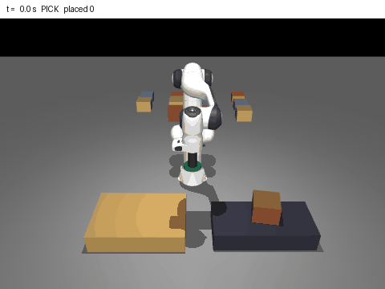
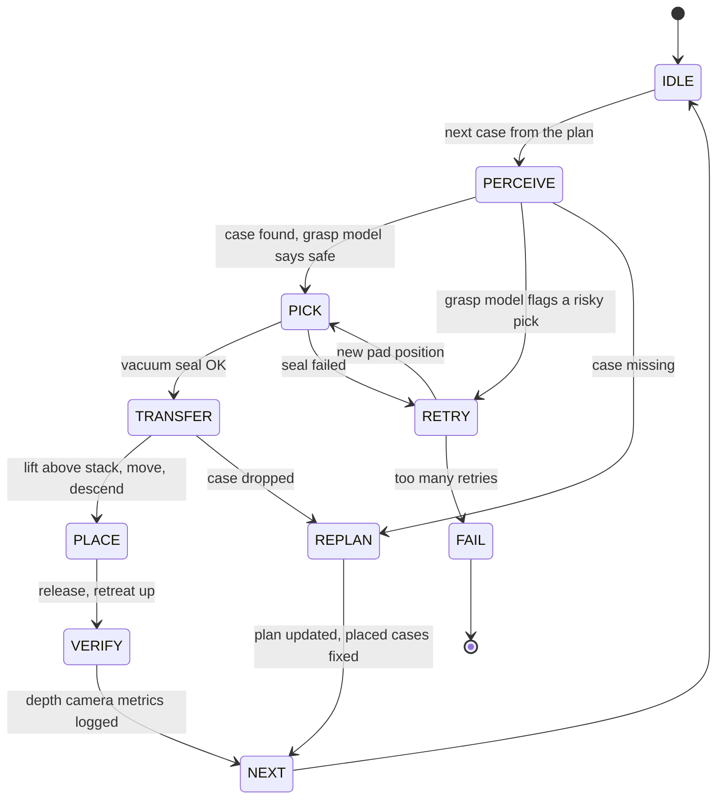

<div align="center">

# Mixed-Case Robotic Palletizing Cell

**A robot arm with a suction cup that stacks mixed cases into stable pallets, and checks its own work.**

A MuJoCo cell: a Franka Panda with a vacuum end-of-arm tool picks four kinds of cases, a state machine runs every
pick and place, a rule-aware planner decides where each case goes, a depth camera with OpenCV measures how each case
landed, and a small PyTorch model warns before risky grasps.

[**Project page →**](https://dheepakkaran.github.io/palletizing-manipulation-cell/) · [Results](RESULTS.md) · [Build notes](BUILD-LOG.md)


</div>

> **Simulation only.** No real robot, gripper, conveyor or sensor. Independent learning project.

---

## Why this exists

Mixed-case palletizing looks simple and is not. Cases differ in size, weight and how much load they can carry on
top; heavy cases must go low and fragile ones high; each layer must be flat for the next one. A suction cup that
lands a centimetre off centre can peel a heavy case off mid-move. And every move over a growing stack can knock a
case that is already placed.

This cell puts those problems in one simulation and measures each one: stacking rules against a first-fit
baseline, placement quality from a depth camera, drops with and without a learned grasp check, and how a change to
the motion strategy moves the share of fully correct pallets.

## Results

Every run uses the same 50 randomized pallets (`eval.py --pallets 50 --seed 0`: 434 cases ordered, 11 missing on purpose).

| Run | Pallets fully correct | Cases dropped | Cases knocked / unstable | Median placement error |
|---|---|---|---|---|
| v1: first motion strategy | 22 / 50 | 13 | 32 | 4.84 mm |
| **v2: vertical approach + retreat** | **36 / 50** | **13** | **0** | **4.62 mm** |
| v2 with the grasp model **off** | 23 / 50 | 36 | 0 | 4.57 mm |

- **Motion fix:** going straight up above the stack top, across, then straight down took the cell from **22 to 36** correct pallets, with no case knocked over.
- **Grasp model:** a 6-32-32-1 MLP trained on 360 curated picks scores **0.956** held-out accuracy, against **0.700** for a pad-offset rule. Gating picks with it cut drops from **36 to 13**.
- **Planner:** **0** stacking-rule violations, against **149** for a first-fit baseline on the same cases (crush 33, heavy-on-light 36, uneven layer 80).
- **Depth camera:** all 409 placed cases found; placement error mean 4.76 mm, p95 7.17 mm.

Every number comes from a file in [`results/`](results/); full tables are in [RESULTS.md](RESULTS.md).

### Demo: evaluation pallet 0, replayed and rendered



*A headless MuJoCo render (EGL) of pallet 0 from the evaluation (seed 0, grasp model on): 10 cases, heavy ones low,
fragile ones on top, 97.8 s simulated. The replay starts from the same random generator, case order and grasp model
as the evaluation and is checked against `results/eval_pallets.jsonl`. One frame every 0.5 s of simulated time.
Made by `render_pallet_gif.py`.*

| Finished pallet (side view) | Pallet camera: depth + OpenCV contours |
|---|---|
|  |  |

## How it works



1. **Cases** (`cases.py`): 4 types, each with a size, a mass (≤ 3 kg, the Panda's payload) and a crush rating (max kg on top).
2. **Scene** (`build_scene.py` → `scene/cell.xml`): Panda + vacuum tool, conveyor pick zone, pallet, 12 free cases, one `weld` per case as the vacuum grip, pick / pallet / overview cameras.
3. **Vacuum gripper + motion** (`sim.py`): seal check (pad contact + ≥ 50% pad overlap); every step compares pull force and peel torque against vacuum capacity and drops the case with a cause. Damped-least-squares IK, vertical approach and retreat at a safe height above the stack.
4. **State machine** (`state_machine.py`): the diagram above; illegal transitions raise; every transition is logged to JSONL.
5. **Layer planner** (`planner.py`): greedy rule-aware layers (heavy and strong low, crush limits, flat layers) that replan around missing cases; first-fit baseline + rule checker.
6. **Vision + metrics** (`vision.py`, `metrics.py`): RGB-D render → height map → OpenCV contours + `minAreaRect` (centre, footprint, yaw) + plane fit (tilt) → placement error, gap to neighbours, layer flatness.
7. **Grasp model** (`grasp_model.py`): randomized pick sweep → curated dataset → PyTorch MLP vs offset rule on a held-out split.

## Design decisions

| Decision | Why |
|---|---|
| **Vacuum grip as a MuJoCo weld plus a force check** | a weld holds the case; the per-step pull and peel check decides when the seal would let go, with a logged cause |
| **Explicit state machine, illegal transitions raise** | every pick follows the same path, and every retry, replan and failure is in the log |
| **Rules in the planner, checked by a separate checker** | the same checker scores the planner and the first-fit baseline, so 0 vs 149 is a fair count |
| **Vertical approach and retreat above the stack top** | joint moves between waypoints swept carried cases through 2–3 cm gaps and knocked 32 placed cases |
| **Learned grasp check that triggers a retry** | the offset rule looks only at pad offset; the MLP also sees case mass, size and pad overlap: 0.956 vs 0.700 held-out |
| **Measure placement from the depth camera** | the cell judges its own work the way a real cell would, not from simulator truth; truth is kept only for the stability check |

## What broke / what changed

1. **The weld force was the wrong signal.** It also carried the pad pressing down on the case, so every pick "dropped". The holding check now uses F = m(a − g) and the peel torque |r × F| from the case's measured acceleration.
2. **Joint-space descents swung sideways** and knocked neighbours; moves became straight TCP lines with IK at 10 points.
3. **IK picked odd branches at the far pallet corner.** An elbow-up seed with joint 7 set for the wanted yaw fixed it, and the pallet moved 3–4 cm closer.
4. **The arm hid the cameras**; the pick camera moved to the side and the arm parks before VERIFY.
5. **v1 knocked 32 placed cases.** The v2 vertical lift took the cell from 22 to 36 correct pallets.
6. **A dead end:** a level 20-waypoint transfer caused acceleration spikes and 37 drops in about 8 pallets, so it was dropped and is not in the results.

## Run it

Needs Python 3.12 and [uv](https://docs.astral.sh/uv/). Runs headless on CPU.

```bash
uv venv --python 3.12 .venv
uv pip install --python .venv/bin/python mujoco numpy opencv-python-headless pytest pillow
uv pip install --python .venv/bin/python torch --index-url https://download.pytorch.org/whl/cpu
export MUJOCO_GL=egl                                        # headless rendering

.venv/bin/python build_scene.py                             # writes scene/cell.xml
.venv/bin/python grasp_model.py sweep --n 360 --workers 3   # curated pick data
.venv/bin/python grasp_model.py train                       # train the grasp model
.venv/bin/python eval.py --pallets 50 --workers 3 --seed 0  # the 50-pallet eval
.venv/bin/python -m pytest -q                               # 9 tests
.venv/bin/python failure_breakdown.py && .venv/bin/python make_results.py && .venv/bin/python render_pallet.py
.venv/bin/python render_pallet_gif.py                       # docs/assets/ GIF + frame strip
```

## Repo map

| Path | What |
|---|---|
| `cases.py` · `build_scene.py` · `scene/` | case types · scene generator · MJCF (Panda + suction tool, cell) |
| `sim.py` | vacuum gripper, holding check, IK, moves |
| `state_machine.py` · `planner.py` | pick-and-place state machine · rule-aware layer planner, first-fit baseline, rule checker |
| `vision.py` · `metrics.py` | depth camera + OpenCV · placement metrics |
| `grasp_model.py` | pick sweep, dataset, MLP vs rule |
| `eval.py` · `failure_breakdown.py` · `make_results.py` | 50-pallet evaluation · failure reasons · RESULTS.md |
| `render_pallet.py` · `render_pallet_gif.py` | still pictures · pallet 0 GIF and frame strip |
| `tests/test_cell.py` | 9 pytest checks |
| `results/` | eval summaries (v1, v2, model off), per-case and per-pallet logs, transitions, grasp data + model |
| `docs/index.html` | the project page (GitHub Pages) |

## Limits

- **Simple vacuum model:** holding force = vacuum × sealed area. Drops and grasp labels both come from this model, so the grasp model learns this simulator, not a real suction cup; it was trained on picks from the v1 motion.
- **Injected pad error:** pad positioning error is added on purpose (σ 12 mm) and treated as measured by the pick camera.
- **No conveyor physics:** cases appear at the pick spot in the order the planner asks for.
- **No collision-aware planner:** motion uses safe-height waypoints; the first-fit baseline is rule-checked only, not executed.
- **Remaining failures:** 13 of the 14 failed v2 pallets were peel drops; 1 had an unreachable IK target.

## Next

Lower transfer acceleration for heavy cases, or a seal check that re-measures the offset after contact · retrain
the grasp model on v2 picks · run the offset rule as the gate in the full eval · split vision error from true error.

## Credits

Franka Emika Panda model from [MuJoCo Menagerie](https://github.com/google-deepmind/mujoco_menagerie) (Apache-2.0, see `assets/franka_emika_panda/LICENSE`).
Author: Dheepak Karan Elumalai Santhakumari.
